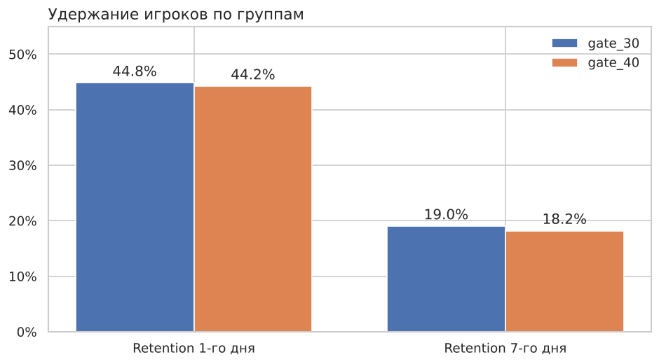
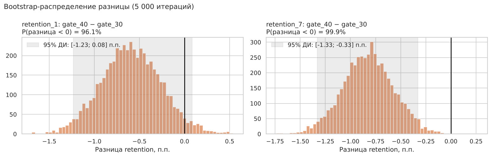
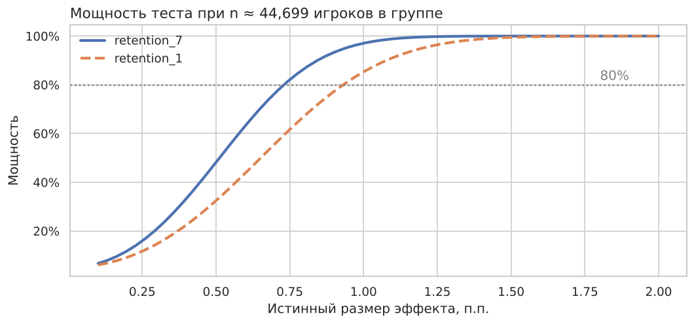

# A/B-тест: перенос «ворот» в мобильной игре Cookie Cats

Полный цикл анализа A/B-теста: проверка данных, проверка корректности сплита (SRM), статистические тесты, bootstrap, анализ мощности и продуктовое решение.

**Стек:** Python (pandas, NumPy, SciPy, matplotlib, seaborn), Jupyter

📓 **Ноутбук:** [`ab_test_cookie_cats.ipynb`](ab_test_cookie_cats.ipynb)

## Задача

В игре Cookie Cats на определённых уровнях стоят «ворота»: чтобы пройти дальше, нужно подождать или заплатить. Команда проверила гипотезу, что перенос первых ворот **с 30-го на 40-й уровень** повысит удержание игроков.

- **Данные:** [Mobile Games A/B Testing — Cookie Cats](https://www.kaggle.com/datasets/yufengsui/mobile-games-ab-testing), 90 189 новых игроков.
- **Группы:** `gate_30` (контроль) и `gate_40` (тест).
- **Основная метрика:** retention 7-го дня. **Дополнительная:** retention 1-го дня. **Барьерная:** число сыгранных раундов.

## Результаты

| Метрика | gate_30 | gate_40 | Разница [95% ДИ] | p-value |
|---|---|---|---|---|
| **Retention 7-го дня** | 19,02% | 18,20% | **−0,82 п.п.** [−1,33; −0,31] | **0.002** |
| Retention 1-го дня | 44,82% | 44,23% | −0,59 п.п. [−1,24; +0,06] | 0.074 |
| Раунды за 14 дней (среднее) | 51,3 | 51,3 | −0,04 [−1,4; +1,3] | 0.051 (Манн–Уитни) |





## Решение

**Не внедрять** перенос ворот. Retention 7-го дня статистически значимо снизился на 4,3% относительно контроля, а активность игроков не выросла. Тест обладал достаточной мощностью: MDE ≈ 0,74 п.п. при 80% мощности.

## Что сделано, помимо базового сравнения

- **Обнаружен SRM** (sample ratio mismatch): в тестовой группе 50,44% игроков, χ² p-value = 0.009. Проверено, что перекос не объясняется неактивными игроками. Результаты интерпретируются с этой оговоркой, а для команды разработки сформулирована рекомендация проверить сплитование.
- **Найден и исключён выброс**: 49 854 раунда за 14 дней у одного игрока (бот или ошибка логирования).
- Для скошенной метрики раундов использованы **тест Манна–Уитни и bootstrap** вместо t-теста.
- **Анализ мощности**: рассчитаны MDE и кривые мощности. Показано, что незначимость retention 1-го дня не означает отсутствия эффекта.



## Структура

```
├── ab_test_cookie_cats.ipynb  # анализ с выводами
├── data/cookie_cats.csv       # исходные данные
├── images/                    # графики
└── requirements.txt
```

## Запуск

```bash
pip install -r requirements.txt
jupyter notebook ab_test_cookie_cats.ipynb
```
